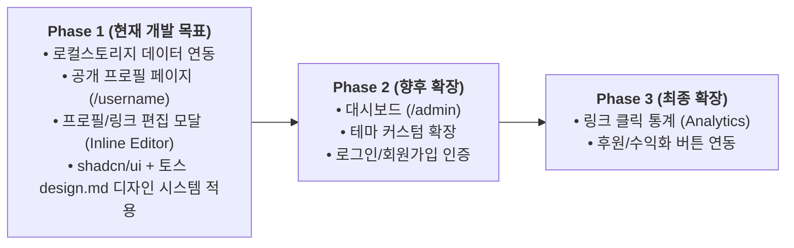

```mermaid
flowchart TD
    subgraph Shell["📱 MyLink App Shell"]
        TopBar["[토스 프로필]  ·  [↗ 공유 버튼]"]

        subgraph Profile["프로필 영역"]
            Avatar["🖼️ Avatar (80×80, Round)"]
            NameHandle["이름 (Name) + 핸들 (Handle)"]
            Bio["한 줄 소개 (Bio)"]
            SocialBadges["[ GitHub ] [ Insta ] [ Email ] — Pill Buttons"]
        end

        subgraph Section1["🚀 주요 프로젝트 & 포트폴리오 (Section Header)"]
            Link1["🎨 마이링크 (MyLink) 서비스 →"]
            Link2["📝 개발 블로그 및 팁 (Velog) →"]
        end

        subgraph Section2["📣 소셜 채널 (Section Header)"]
            Link3["📺 개발자 홍길동 유튜브 채널 →"]
            Link4["💬 1:1 오픈채팅방 →"]
        end

        Footer["Powered by MyLink · 토스 스타일"]
    end

    TopBar --> Profile
    Profile --> Section1
    Section1 --> Section2
    Section2 --> Footer
```

# 📄 [PRD] 링크트리 클론 서비스 "마이링크 (MyLink)"

> [!NOTE]
> **개발 전략 (단계별 시연 로드맵)**
> 현재 시연 단계에서는 **1단계: 로컬스토리지 기반 프로필 랜딩 페이지 및 기본 편집 기능**에 집중하여 신속히 개발을 진행합니다.
> 복잡한 통계/분석 대시보드 및 확장 기능은 2단계 이후 개발 대상으로 분류합니다.

---

## 1. 개발 로드맵 (Phased Roadmap)



---

## 2. 사용자 시나리오 (User Scenarios)

### 👤 시나리오 A: 방문자 (End-User) 관점
1. **페이지 방문**: 크리에이터의 인스타그램 프로필 바이오 링크(예: `mylink.com/creator_kim`)를 클릭하여 마이링크 프로필 랜딩페이지에 접속한다.
2. **프로필 확인**: 깔끔한 토스 TDS 디자인의 카드 레이아웃에서 크리에이터의 프로필 사진, 이름, 한 줄 소개를 한눈에 확인한다.
3. **링크 탐색 및 이동**: 원하는 링크 카드(예: "🎬 유튜브 최신 영상 보러가기") 또는 하단 소셜 아이콘(인스타그램, 이메일 등)을 클릭하여 해당 외부에 있는 타겟 웹페이지로 이동한다.

### ✏️ 시나리오 B: 프로필 소유자 / 시연자 (Owner / Presenter) 관점
1. **시연 모드 진입**: 프로필 랜딩페이지 우측 상단의 '편집' 버튼을 클릭한다.
2. **프로필 수정**: 닉네임, 한 줄 소개, 프로필 아바타 이미지 URL을 변경하고 저장 버튼을 누른다.
3. **링크 관리**:
   - **새 링크 추가**: 제목, 설명, URL, 섹션을 입력하여 새 링크 카드를 생성한다.
   - **링크 수정/삭제**: 기존 링크의 제목을 변경하거나 불필요한 링크를 삭제/비활성화한다.
4. **실시간 반영 확인**: 저장과 동시에 브라우저 `localStorage`에 즉시 데이터가 업데이트되고, 프로필 화면이 새로고침 없이 즉시 새로워진 내용을 보여주는 것을 시연한다.

---

## 3. 와이어프레임 (Wireframes)

> 참고 이미지: [`docs/wireframe-top.png`](./wireframe-top.png) / [`docs/wireframe-full.png`](./wireframe-full.png)

### 3.1. 메인 공개 프로필 화면 — 업데이트된 와이어프레임

```
+--------------------------------------------------+
| [토스 프로필]               [ ↗ ] | ← Top Bar (공유 버튼)
+--------------------------------------------------+
|                                                  |
|          +------------------+                    |
|          |   (Avatar)       | ← Profile Image (Round, 80x80)
|          |    🖼️  80x80     |                    |
|          +------------------+                    |
|                홍길동  (Gildong)   | ← Name & Handle
|        "풀스택 개발자 & 크리에이터 🚀"  | ← Bio (한 줄 소개)
|                                                  |
|     [ GitHub ]  [ Insta ]  [ Email ]             | ← Social Badges (Pill Buttons)
|                                                  |
+--------------------------------------------------+
|                                                  |
| 🚀 주요 프로젝트 & 포트폴리오      | ← Section Header
|                                                  |
|  +--------------------------------------------+ |
|  | 🎨  마이링크 (MyLink) 서비스          →  | | | ← Link Button Card
|  |     토스 디자인 시스템 기반의 바이오 프로필    | |
|  +--------------------------------------------+ |
|                                                  |
|  +--------------------------------------------+ |
|  | 📝  개발 블로그 및 팁 (Velog)         →  | | | ← Link Button Card
|  |     웹 개발 관련 소소한 이야기와 지식을 공유   | |
|  +--------------------------------------------+ |
|                                                  |
| 📣 소셜 채널                       | ← Section Header
|                                                  |
|  +--------------------------------------------+ |
|  | 📺  개발자 홍길동 유튜브 채널         →  | | | ← Link Button Card
|  |     신규 프레임워크 리뷰 및 코딩 시연 라이브   | |
|  +--------------------------------------------+ |
|                                                  |
|  +--------------------------------------------+ |
|  | 💬  1:1 오픈채팅방                    →  | | | ← Link Button Card
|  |     협업 문의 및 질문을 언제든 환영합니다      | |
|  +--------------------------------------------+ |
|                                                  |
|     Powered by MyLink  ·  토스 스타일            | ← Footer
+--------------------------------------------------+
```



---

## 4. Phase 1 핵심 기능 명세 (Current Scope)

### 4.1. 로컬스토리지 기반 프로필 데이터 지속화
- 서버/DB 없이 브라우저 `localStorage`를 데이터 원천(Single Source of Truth)으로 활용.
- 페이지 진입 시 `localStorage`의 데이터를 읽어와 프로필 및 링크 카드 렌더링.
- 최초 방문 시 시연용 **기본 샘플 데이터(Mock Data)** 자동 로드.

### 4.2. 공개 프로필 랜딩 페이지 (`/username`)
- **모바일 퍼스트 레이아웃** (Tailwind CSS + shadcn/ui 기반)
- **Top Bar**: "토스 프로필" 텍스트 + 우측 공유(↗) 버튼 + 편집 버튼
- **프로필 섹션**: 아바타(80×80 Round), 이름(`display_name`), 핸들(`handle`), 한 줄 소개(`bio`), 소셜 뱃지(GitHub/Insta/Email — Pill 버튼)
- **섹션 헤더 + 링크 카드 리스트**: 섹션별로 그룹화된 링크 표출 (제목 + 설명 + → 화살표)
- **Footer**: `Powered by MyLink · 토스 스타일`

### 4.3. 컴포넌트 구조 (shadcn/ui 기반)
| 컴포넌트 | 경로 | 역할 |
|---------|------|------|
| `LinkCard` | `src/components/link-card.tsx` | 링크 카드 (제목+설명+화살표) |
| `Button`, `Input`, `Card` | `src/components/ui/*` | shadcn/ui 기본 컴포넌트 |

### 4.4. 간이 프로필/링크 편집기 (Profile & Link Editor)
- 시연 및 테스트를 위해 프로필 페이지 내에서 직접 프로필 및 링크 항목을 수정/추가/삭제할 수 있는 **편집 모달** 제공
- 편집 내용 수정 즉시 `localStorage` 저장 및 프로필 화면에 실시간 반영
- 링크마다 **섹션(section)** 지정 가능 → 섹션 헤더별 그룹화 표시

---

## 5. 디자인 시스템 가이드라인 (shadcn/ui + Toss TDS design.md)

마이링크의 UI/UX는 **shadcn/ui 컴포넌트 라이브러리**를 기본 구조로 채택하고, **토스 디자인 가이드(`design.md`)**의 디자인 토큰과 토스 특유의 감성을 결합하여 구현합니다. **모든 스타일은 Tailwind CSS 유틸리티 클래스로 통일합니다.**

- **컴포넌트 베이스**: `shadcn/ui` (`@/components/ui/*`)
- **스타일링**: Tailwind CSS (module CSS 미사용)
- **디자인 토큰 & 스타일**: 토스 Design System (`design.md`)
  - **Primary Color**: Toss Blue (`#3182F6` / `blue-500`)
  - **Background**: `bg-gray-50`, 카드: `bg-white`
  - **Typography**: `text-gray-900` (Primary), `text-gray-600` (Secondary), `text-gray-400` (Tertiary)
  - **Border Radius**: `rounded-full` (Pill), `rounded-2xl` (Card), `rounded-xl` (Button)
  - **Interactions**: Hover `bg-gray-50/100`, transition-colors

---

## 6. 기술 스택 및 상태 관리 (Tech Stack)

| 영역 | 기술 스택 | 비고 |
| :--- | :--- | :--- |
| **Frontend** | React / Next.js 16, Tailwind CSS | 반응형 Web UI 및 모바일 퍼스트 레이아웃 |
| **Design System** | **shadcn/ui + 토스 TDS (`design.md`)** | shadcn/ui 기반 컴포넌트 + Tailwind 스타일링 |
| **State & Storage** | React useState + LocalStorage | `localStorage` 데이터를 React state와 연결 |
| **Deployment** | Vercel / GitHub Pages | 클라이언트 사이드 단독 배포 |

---

## 7. Phase 1 LocalStorage 및 더미 데이터 구조

### 7.1. LocalStorage 기본 샘플 데이터 (`mylink_profile` & `mylink_links`)

```json
{
  "mylink_profile": {
    "username": "creator_kim",
    "display_name": "홍길동",
    "handle": "Gildong",
    "bio": "풀스택 개발자 & 크리에이터 🚀",
    "avatar_url": "https://images.unsplash.com/photo-1534528741775-53994a69daeb?w=400",
    "socials": {
      "github": "https://github.com",
      "instagram": "https://instagram.com",
      "email": "mailto:creator@example.com"
    }
  },
  "mylink_links": [
    {
      "id": "link_1",
      "title": "🎨 마이링크 (MyLink) 서비스",
      "description": "토스 디자인 시스템 기반의 바이오 프로필 서비스",
      "url": "https://github.com",
      "section": "🚀 주요 프로젝트 & 포트폴리오",
      "is_active": true,
      "display_order": 1
    },
    {
      "id": "link_2",
      "title": "📝 개발 블로그 및 팁 (Velog)",
      "description": "웹 개발 관련 소소한 이야기와 지식을 공유합니다",
      "url": "https://velog.io",
      "section": "🚀 주요 프로젝트 & 포트폴리오",
      "is_active": true,
      "display_order": 2
    },
    {
      "id": "link_3",
      "title": "📺 개발자 홍길동 유튜브 채널",
      "description": "신규 프레임워크 리뷰 및 코딩 시연 라이브",
      "url": "https://youtube.com",
      "section": "📣 소셜 채널",
      "is_active": true,
      "display_order": 3
    },
    {
      "id": "link_4",
      "title": "💬 1:1 오픈채팅방",
      "description": "협업 문의 및 질문을 언제든 환영합니다",
      "url": "https://open.kakao.com",
      "section": "📣 소셜 채널",
      "is_active": true,
      "display_order": 4
    }
  ]
}
```

---

## 8. 2단계 및 3단계 대상 기능 (Post-Phase 1 Backlog)

- **Phase 2**: 대시보드 관리자 페이지 (`/admin`), 다중 테마 선택기, 회원가입/로그인 세션 관리
- **Phase 3**: 링크 클릭 및 페이지 방문 수 통계 (Analytics & Chart), 카카오페이/토스 후원 버튼 연동
