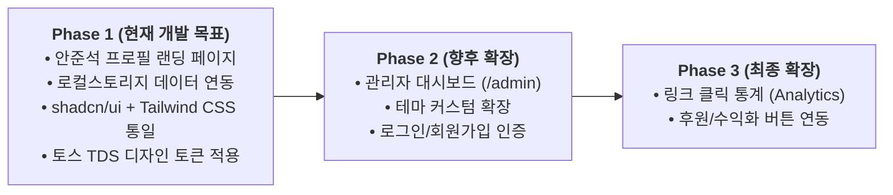

```mermaid
flowchart TD
    subgraph Shell["📱 MyLink App Shell (안준석 프로필)"]
        TopBar["[토스 프로필]  ·  [↗ 공유 버튼]"]

        subgraph Profile["프로필 영역"]
            Avatar["📷 Avatar (80×80 Round)"]
            NameHandle["안준석 (Junseok)"]
            Bio["풀스택 개발자 & 크리에이터 🚀"]
            Badges["[ GitHub ] [ Insta ] [ Email ] (Pill Buttons)"]
        end

        subgraph Section1["🚀 주요 프로젝트 & 포트폴리오 (Section Header)"]
            Link1["🎨 마이링크 (MyLink) 서비스 →"]
            Link2["📖 개발 블로그 및 팁 (Velog) →"]
        end

        subgraph Section2["📢 소셜 채널 (Section Header)"]
            Link3["📺 개발자 안준석 유튜브 채널 →"]
            Link4["💬 1:1 오픈채팅방 →"]
        end

        Footer["Powered by MyLink · 토스 스타일"]
    end

    TopBar --> Profile
    Profile --> Section1
    Section1 --> Section2
    Section2 --> Footer
```

# 📄 [PRD] 링크트리 클론 서비스 "마이링크 (MyLink)"

> **서비스 소유자**: 안준석 (Junseok)  
> **GitHub 저장소**: https://github.com/junseok1028/mylink  
> **참조 와이어프레임 문서**: [`docs/wireframe.md`](./wireframe.md)

---

## 1. 개발 로드맵 (Phased Roadmap)



---

## 2. 사용자 시나리오 (User Scenarios)

### 👤 시나리오 A: 방문자 (End-User) 관점
1. **페이지 방문**: 사용자의 SNS 바이오 링크(예: `github.com/junseok1028/mylink` 또는 프로필 링크)를 통해 마이링크 웹페이지에 접속한다.
2. **프로필 확인**: 토스 스타일의 상단 탑바(`[토스 프로필]`, 공유 버튼), 80x80 원형 아바타, `안준석 (Junseok)`, `"풀스택 개발자 & 크리에이터 🚀"` 및 `[ GitHub ] [ Insta ] [ Email ]` 알약(Pill) 버튼을 확인한다.
3. **섹션별 링크 탐색 및 이동**:
   - `🚀 주요 프로젝트 & 포트폴리오` 섹션에서 `🎨 마이링크 (MyLink) 서비스`, `📖 개발 블로그 및 팁 (Velog)` 링크 카드를 확인하고 타겟 URL로 이동한다.
   - `📢 소셜 채널` 섹션에서 `📺 개발자 안준석 유튜브 채널`, `💬 1:1 오픈채팅방` 링크 카드를 확인하고 참여한다.
4. **공유 액션**: 상단 우측의 `[ ↗ ]` 공유 버튼을 눌러 프로필 URL을 복사하거나 SNS로 공유한다.

### ✏️ 시나리오 B: 프로필 소유자 (Owner: 안준석) 관점
1. **시연 모드 진입**: 상단 헤더 우측의 '편집' 버튼을 클릭하여 편집 모달을 띄운다.
2. **프로필 수정**: 이름, 핸들, 바이오, 소셜 링크(GitHub/Insta/Email)를 수정하고 저장한다.
3. **링크 관리**: 링크 제목, 상세 설명, URL, 소속 섹션을 관리(추가/수정/삭제/노출 토글)한다.
4. **즉시 반영**: `localStorage`에 자동 영속화되며 새로고침 없이 즉시 화면에 반영된다.

---

## 3. 와이어프레임 텍스트 사양 (Wireframes Spec)

```text
+---------------------------------------------------------------------------------+
| 📱 [MyLink App Shell]                                                           |
+---------------------------------------------------------------------------------+
| [토스 프로필]                                         [ ↗ ] | <-- Top Bar (공유 버튼)  |
+---------------------------------------------------------------------------------+
|                                                                                 |
|                   +-------------------------+                                   |
|                   |        (Avatar)         |       | <-- Profile Image         |
|                   |        📷 80x80         |             (Round Card)          |
|                   +-------------------------+                                   |
|                                                                                 |
|                        안준석  (Junseok)            | <-- Name & Handle         |
|                  "풀스택 개발자 & 크리에이터 🚀"        | <-- Bio (한 줄 소개)       |
|                                                                                 |
|              [ GitHub ]   [ Insta ]   [ Email ]     | <-- Social Badges         |
|                                                           (Pill Buttons)        |
+---------------------------------------------------------------------------------+
|                                                                                 |
| 🚀 주요 프로젝트 & 포트폴리오                         | <-- Section Header        |
|                                                                                 |
| +-----------------------------------------------------------------------------+ |
| | 🎨 마이링크 (MyLink) 서비스                           | | <-- Link Button Card| |
| |    토스 디자인 시스템 기반의 바이오 프로필 서비스      → | |                     | |
| +-----------------------------------------------------------------------------+ |
|                                                                                 |
| +-----------------------------------------------------------------------------+ |
| | 📖 개발 블로그 및 팁 (Velog)                          | | <-- Link Button Card| |
| |    웹 개발 관련 소소한 이야기와 지식을 공유합니다      → | |                     | |
| +-----------------------------------------------------------------------------+ |
|                                                                                 |
| 📢 소셜 채널                                          | <-- Section Header        |
|                                                                                 |
| +-----------------------------------------------------------------------------+ |
| | 📺 개발자 안준석 유튜브 채널                          | | <-- Link Button Card| |
| |    신규 프레임워크 리뷰 및 코딩 시연 라이브            → | |                     | |
| +-----------------------------------------------------------------------------+ |
|                                                                                 |
| +-----------------------------------------------------------------------------+ |
| | 💬 1:1 오픈채팅방                                     | | <-- Link Button Card| |
| |    협업 문의 및 질문을 언제든 환영합니다               → | |                     | |
| +-----------------------------------------------------------------------------+ |
|                                                                                 |
|           Powered by MyLink  ·  토스 스타일           | <-- Footer                |
+---------------------------------------------------------------------------------+
```



---

## 4. Phase 1 핵심 기능 명세 (Feature Spec)

### 4.1. 상단 Top Bar & 내비게이션
- 상단 고정 헤더: 좌측 `토스 프로필` 텍스트, 우측 `[ ↗ ]` 공유 아이콘 버튼 및 `편집` 버튼
- 공유 버튼 클릭 시 Web Share API 우선 호출, 미지원 환경에서는 클립보드 복사 + 토스 토스트 알림 노출

### 4.2. 프로필 섹션 (Profile Section)
- **아바타**: 80×80px 원형 (`rounded-full`, 테두리 링 및 그림자)
- **이름 및 핸들**: `안준석 (Junseok)` (TDS grey-900 Bold & 서브텍스트)
- **한 줄 소개**: `"풀스택 개발자 & 크리에이터 🚀"` (TDS grey-700)
- **소셜 뱃지**: `[ GitHub ]`, `[ Insta ]`, `[ Email ]` (Full Pill `rounded-full` 버튼, 클릭 시 외부 링크 이동)

### 4.3. 섹션별 링크 카드 리스트 (Grouped Link Cards)
- 링크 데이터의 `section` 필드에 따라 그룹화하여 섹션 헤더 노출
- **개별 링크 카드 구성**:
  - 좌측 상단: 아이콘 + 제목 (굵은 글씨, `#191F28`)
  - 좌측 하단: 부가 설명 텍스트 (`#4E5968`, 13px)
  - 우측: `→` 화살표 아이콘 (`#8B95A1`)
  - TDS 인터랙션: hover 시 카드 배경색 변경, click/active 시 부드러운 스케일 피드백

### 4.4. 푸터 (Footer)
- `Powered by MyLink · 토스 스타일` 문구 표기 (Toss Blue `#3182F6` 강조)

### 4.5. 로컬스토리지 지속화 및 인라인 편집기
- 브라우저 `localStorage` 기반 단일 진실 공급원(`mylink_profile`, `mylink_links`)
- 편집 모달을 통해 이름/소개/아바타/소셜링크/링크카드 추가 및 삭제, 활성 토글 실시간 지원

---

## 5. 디자인 시스템 및 기술 스택 (Tailwind CSS + shadcn/ui + design.md)

- **스타일링 원칙**: **모듈 CSS 완전 배제 및 Tailwind CSS 통일**.
- **컴포넌트 기반**: **shadcn/ui** (`@/components/ui/*`) 컴포넌트 기반 설계
- **토스 디자인 토큰 (`design.md`) 매핑**:
  - **Brand / Primary**: 토스 블루 (`#3182F6` / `text-blue-500` / `bg-blue-600`)
  - **Surface Background**: 라이트 그레이 (`#F9FAFB` / `bg-[#F9FAFB]`), 카드 표면 (`#FFFFFF` / `bg-white`)
  - **Text Colors**: Primary (`#191F28`), Secondary (`#4E5968`), Placeholder (`#8B95A1`)
  - **Border Radius**: Card (`rounded-2xl`, 20px), Pill Badge (`rounded-full`), Input/Button (`rounded-xl`)
  - **Border & Shadow**: `border border-gray-100`, `shadow-sm`

---

## 6. 재사용 컴포넌트 아키텍처

| 컴포넌트 | 파일 경로 | 설명 |
| :--- | :--- | :--- |
| `LinkCard` | `src/components/link-card.tsx` | 와이어프레임의 제목+설명+화살표(→) 링크 버튼 카드 |
| `Button` | `src/components/ui/button.tsx` | shadcn/ui 기반 토스 스타일 버튼 |
| `Card` | `src/components/ui/card.tsx` | shadcn/ui 기반 컨테이너 카드 |
| `Input` | `src/components/ui/input.tsx` | shadcn/ui 기반 텍스트 인풋 필드 |

---

## 7. Phase 1 LocalStorage 초기 데이터 모델

```json
{
  "mylink_profile": {
    "username": "junseok1028",
    "display_name": "안준석",
    "handle": "Junseok",
    "bio": "풀스택 개발자 & 크리에이터 🚀",
    "avatar_url": "https://images.unsplash.com/photo-1534528741775-53994a69daeb?w=400",
    "socials": {
      "github": "https://github.com/junseok1028/mylink",
      "instagram": "https://instagram.com",
      "email": "mailto:junseok1028@example.com"
    }
  },
  "mylink_links": [
    {
      "id": "link_1",
      "title": "🎨 마이링크 (MyLink) 서비스",
      "description": "토스 디자인 시스템 기반의 바이오 프로필 서비스",
      "url": "https://github.com/junseok1028/mylink",
      "section": "🚀 주요 프로젝트 & 포트폴리오",
      "is_active": true,
      "display_order": 1
    },
    {
      "id": "link_2",
      "title": "📖 개발 블로그 및 팁 (Velog)",
      "description": "웹 개발 관련 소소한 이야기와 지식을 공유합니다",
      "url": "https://velog.io",
      "section": "🚀 주요 프로젝트 & 포트폴리오",
      "is_active": true,
      "display_order": 2
    },
    {
      "id": "link_3",
      "title": "📺 개발자 안준석 유튜브 채널",
      "description": "신규 프레임워크 리뷰 및 코딩 시연 라이브",
      "url": "https://youtube.com",
      "section": "📢 소셜 채널",
      "is_active": true,
      "display_order": 3
    },
    {
      "id": "link_4",
      "title": "💬 1:1 오픈채팅방",
      "description": "협업 문의 및 질문을 언제든 환영합니다",
      "url": "https://open.kakao.com",
      "section": "📢 소셜 채널",
      "is_active": true,
      "display_order": 4
    }
  ]
}
```
