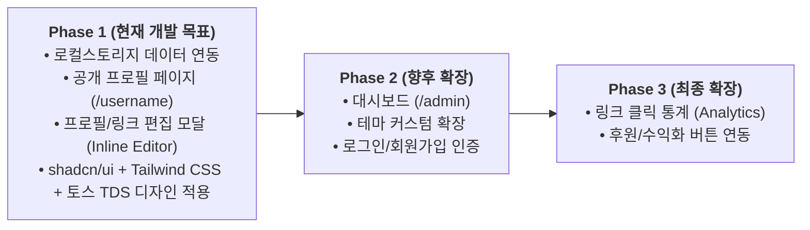
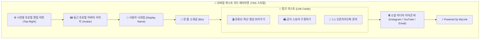

# 📄 [PRD] 링크트리 클론 서비스 "마이링크 (MyLink)"

> [!NOTE]
> **개발 전략 (단계별 시연 로드맵)**
> 현재 시연 단계에서는 **1단계: 로컬스토리지 기반 프로필 랜딩 페이지 및 기본 편집 기능**에 집중하여 신속히 개발을 진행합니다.
> 복잡한 통계/분석 대시보드 및 확장 기능은 2단계 이후 개발 대상으로 분류합니다.

---

## 1. 개발 로드맵 (Phased Roadmap)



---

## 2. 사용자 시나리오 (User Scenarios)

### 👤 시나리오 A: 방문자 (End-User) 관점
1. **페이지 방문**: 크리에이터의 인스타그램 프로필 바이오 링크(예: `mylink.com/creator_kim`)를 클릭하여 마이링크 프로필 랜딩페이지에 접속한다.
2. **프로필 확인**: 깔끔한 토스 TDS 디자인의 카드 레이아웃에서 크리에이터의 프로필 사진, 이름, 한 줄 소개를 한눈에 확인한다.
3. **링크 탐색 및 이동**: 원하는 링크 카드(예: "🎬 유튜브 최신 영상 보러가기") 또는 하단 소셜 아이콘(인스타그램, 유튜브, 이메일 등)을 클릭하여 해당 외부에 있는 타겟 웹페이지로 이동한다.

### ✏️ 시나리오 B: 프로필 소유자 / 시연자 (Owner / Presenter) 관점
1. **시연 모드 진입**: 프로필 랜딩페이지 우측 상단의 '⚙️ 편집' 버튼을 클릭하여 편집 모달을 연다.
2. **프로필 수정**: 닉네임, 한 줄 소개, 프로필 아바타 이미지 URL을 변경하고 저장 버튼을 누른다.
3. **링크 관리**:
   - **새 링크 추가**: 제목과 URL을 입력하여 새 링크 카드를 생성한다.
   - **링크 수정/삭제**: 기존 링크의 제목을 변경하거나 불필요한 링크를 삭제/비활성화한다.
4. **실시간 반영 확인**: 저장과 동시에 브라우저 `localStorage`에 즉시 데이터가 업데이트되고, 프로필 화면이 새로고침 없이 즉시 새로워진 내용을 보여주는 것을 시연한다.

---

## 3. 와이어프레임 (Wireframes)

### 3.1. 메인 공개 프로필 화면 (`/creator_kim`) - 방문자 관점

```
+-------------------------------------------------------------+
|                                                             |
|                   [ ⚙️ 편집 (시연용 토글) ]                   |  <- 우측 상단 편집 버튼
|                                                             |
|                          ( O )                              |  <- 80x80 둥근 아바타 이미지
|                      김크리에이터                            |  <- display_name (grey-900, Bold)
|        안녕하세요! 마이링크에 오신 것을 환영합니다 🚀           |  <- bio (grey-700)
|                                                             |
|  +-------------------------------------------------------+  |
|  |  🎬  유튜브 최신 영상 보러가기                      🔗 |  |  <- 링크 카드 1 (TDS rounded-2xl)
|  +-------------------------------------------------------+  |
|                                                             |
|  +-------------------------------------------------------+  |
|  |  🛍️  공식 스토어 구경하기                          🔗 |  |  <- 링크 카드 2
|  +-------------------------------------------------------+  |
|                                                             |
|  +-------------------------------------------------------+  |
|  |  💬  1:1 오픈카카오톡 문의                          🔗 |  |  <- 링크 카드 3
|  +-------------------------------------------------------+  |
|                                                             |
|                 [ 📸 ]   [ 🎥 ]   [ ✉️ ]                    |  <- 소셜 아이콘 바 (인스타/유튜브/이메일)
|                                                             |
|                      Powered by MyLink                      |  <- 푸터 브랜드 표기
|                                                             |
+-------------------------------------------------------------+
```



---

## 4. Phase 1 핵심 기능 명세 (Current Scope)

### 4.1. 로컬스토리지 기반 프로필 데이터 지속화
- 서버/DB 없이 브라우저 `localStorage`를 데이터 원천(Single Source of Truth)으로 활용.
- 페이지 진입 시 `localStorage`의 데이터를 읽어와 프로필 및 링크 카드 렌더링.
- 최초 방문 시 시연용 **기본 샘플 데이터(Mock Data)** 자동 로드.

### 4.2. 공개 프로필 랜딩 페이지 (`/username`)
- **모바일 퍼스트 레이아웃** (`max-w-md mx-auto`)
- **프로필 영역**: 80×80 원형 아바타, 닉네임(`display_name`, bold), 한 줄 소개(`bio`)
- **링크 카드 리스트**:
  - 활성화된 링크 표출 (클릭 시 해당 URL로 이동)
  - `LinkCard` 컴포넌트로 분리 및 재사용 가능 구조
  - Hover 및 Active 피드백 (TDS 인터랙션)
- **소셜 아이콘 바**: 하단 SNS 연결 버튼 (인스타그램 📸, 유튜브 🎥, 이메일 ✉️)
- **푸터**: `Powered by MyLink` 브랜드 표기

### 4.3. 간이 프로필/링크 편집기 (Profile & Link Editor)
- 시연 및 테스트를 위해 프로필 페이지 내에서 직접 프로필 및 링크 항목을 수정/추가/삭제할 수 있는 **편집 모달/토글 기능** 제공
- 편집 내용 수정 즉시 `localStorage` 저장 및 프로필 화면에 실시간 반영

---

## 5. 디자인 시스템 및 스타일 가이드라인 (Tailwind CSS + shadcn/ui + design.md)

- **스타일링 원칙**: **모듈 CSS(`*.module.css`, `toss.css`)를 사용하지 않고 전면 Tailwind CSS로 통일**.
- **컴포넌트 구조**: **shadcn/ui** 구조 기반(`@/components/ui/*`)으로 컴포넌트를 설계하여 높은 재사용성과 접근성을 보장.
- **디자인 토큰 (`design.md` 기준)**:
  - **Primary CTA / Brand Color**: 토스 블루 (`#3182F6` / `bg-blue-500` / `text-blue-500`)
  - **Surface & Background**:
    - 라이트 캔버스: `#F9FAFB` (`bg-[#F9FAFB]` 또는 `bg-gray-50`)
    - 카드 컨테이너: `#FFFFFF` (`bg-white`)
  - **Typography & Text Colors**:
    - Primary Text: `#191F28` (`text-[#191F28]`, Pure Black 금지)
    - Secondary Text: `#4E5968` (`text-[#4E5968]`)
    - Tertiary / Placeholder: `#8B95A1` (`text-[#8B95A1]`)
  - **Border Radius**:
    - 링크 카드: `rounded-2xl` (20px, TDS standard)
    - 버튼 / 모달: `rounded-xl` ~ `rounded-2xl`
    - 아바타 / 소셜 버튼: `rounded-full` (999px pill)
  - **Elevation & Border**:
    - 1px 미세 테두리 (`border border-gray-100` / `border-gray-200`)
    - 부드러운 그림자 (`shadow-sm`) 및 Hover 시 배경 변경 인터랙션

---

## 6. 재사용 컴포넌트 구성 (Component Architecture)

| 컴포넌트 | 경로 | 설명 |
| :--- | :--- | :--- |
| `LinkCard` | `src/components/link-card.tsx` | 개별 링크를 렌더링하는 shadcn/ui Card 기반 재사용 카드 컴포넌트 |
| `ProfileCard` | `src/components/profile-card.tsx` | 아바타, 이름, 바이오를 렌더링하는 프로필 헤더 컴포넌트 |
| `SocialLinks` | `src/components/social-links.tsx` | 하단 인스타/유튜브/이메일 소셜 아이콘 바 컴포넌트 |
| `Button` | `src/components/ui/button.tsx` | shadcn/ui 기반 버튼 (Toss 토큰 적용) |
| `Card` | `src/components/ui/card.tsx` | shadcn/ui 기반 카드 컨테이너 |
| `Input` | `src/components/ui/input.tsx` | shadcn/ui 기반 입력 필드 |

---

## 7. Phase 1 LocalStorage 및 샘플 데이터 구조

```json
{
  "mylink_profile": {
    "username": "creator_kim",
    "display_name": "김크리에이터",
    "bio": "안녕하세요! 마이링크에 오신 것을 환영합니다 🚀",
    "avatar_url": "https://images.unsplash.com/photo-1534528741775-53994a69daeb?w=400",
    "socials": {
      "instagram": "https://instagram.com",
      "youtube": "https://youtube.com",
      "email": "mailto:creator@example.com"
    }
  },
  "mylink_links": [
    {
      "id": "link_1",
      "title": "🎬 유튜브 최신 영상 보러가기",
      "url": "https://youtube.com",
      "is_active": true,
      "display_order": 1
    },
    {
      "id": "link_2",
      "title": "🛍️ 공식 스토어 구경하기",
      "url": "https://smartstore.naver.com",
      "is_active": true,
      "display_order": 2
    },
    {
      "id": "link_3",
      "title": "💬 1:1 오픈카카오톡 문의",
      "url": "https://open.kakao.com",
      "is_active": true,
      "display_order": 3
    }
  ]
}
```

---

## 8. 후속 개발 로드맵 (Post-Phase 1 Backlog)

- **Phase 2**: 관리자 대시보드 (`/admin`), 테마 커스텀 확장, 회원가입/로그인 인증
- **Phase 3**: 링크 클릭 및 유입 통계 분석 (Analytics), 토스페이/카카오페이 후원 버튼 연동
